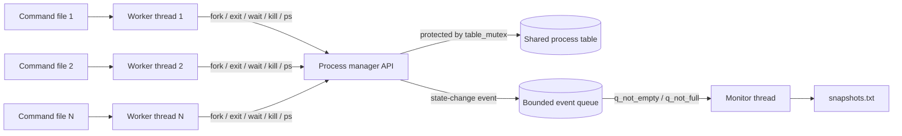
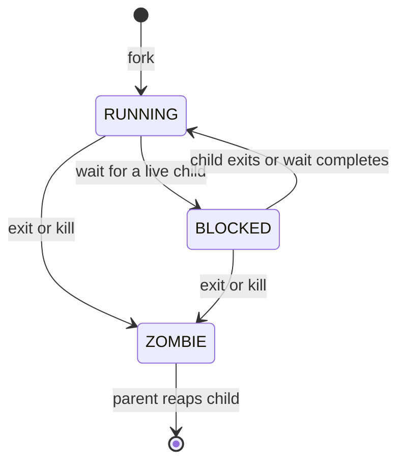
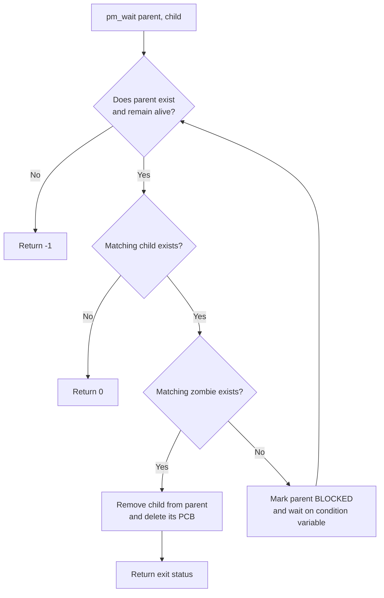

# Multithreaded Process Manager

A thread-safe process manager simulator written in C with POSIX Threads (`pthreads`). Multiple worker threads read command files concurrently and operate on a shared process table, while a dedicated monitor thread records a consistent snapshot after every state-changing operation.

This project was developed for the **CSE321 Operating Systems Lab**, Section 19, Group 03.

## Team

| Student | ID |
|---|---:|
| Md. Meheraz Hossain Chayan | 22299263 |
| A.A.M Miad Islam | 22299417 |

## Features

- Simulates process creation, termination, waiting, killing, and process-table inspection.
- Executes independent command files concurrently using worker threads.
- Protects the shared process table with a mutex.
- Uses condition variables to block and wake waiting parent processes.
- Preserves terminated children as zombies until their parent reaps them.
- Supports waiting for a specific child or the earliest terminated child.
- Sends immutable process-table snapshots through a bounded producer-consumer queue.
- Writes an ordered event log to `snapshots.txt` from a dedicated monitor thread.

## Architecture



The process-table mutex makes each operation atomic. The separate queue mutex allows the monitor to write snapshots without holding the process-table lock during file I/O.

## Process Lifecycle



- `RUNNING`: the simulated process is active.
- `BLOCKED`: one or more worker threads are waiting on one of its children.
- `ZOMBIE`: the process has terminated but has not yet been reaped by its parent.

## Wait Operation Flow



Passing `-1` as the child PID waits for any child. If several children are zombies, the child that exited first is reaped first.

## Requirements

- A C compiler with POSIX Threads support, such as GCC or Clang
- Linux, WSL, macOS, or another POSIX-compatible environment

> Native Microsoft Visual C does not provide the POSIX `pthread` API used by this project. On Windows, compile inside WSL or use a compatible environment such as MSYS2.

## Build

From the project directory:

```bash
gcc -std=c11 -Wall -Wextra -Wpedantic -pthread \
  Project_Sec_19_Group_3.c -o process_manager
```

## Command Files

Each worker receives one plain-text command file. Blank lines and lines beginning with `#` are ignored.

| Command | Meaning |
|---|---|
| `fork <parent_pid>` | Create a running child and return the next available PID. |
| `exit <pid> <status>` | Terminate a process with the supplied exit status. |
| `kill <pid>` | Terminate a process with status `-9`. |
| `wait <parent_pid> <child_pid>` | Wait for a specific child; use `-1` to wait for any child. |
| `sleep <milliseconds>` | Pause the worker to help coordinate a scenario. |
| `ps` | Print the current process table to standard output. |

The simulator starts with PID 1 in the `RUNNING` state. New PIDs begin at 2.

Example `thread0.txt`:

```text
# PID 1 creates PID 2
fork 1
sleep 100
wait 1 2
ps
```

Example `thread1.txt`:

```text
sleep 50
exit 2 0
```

When several files issue `fork` concurrently, PID assignment follows the actual lock-acquisition order and may vary between runs. Use `sleep` commands when a test depends on a particular ordering.

## Run

Pass one or more command files. The program creates one worker thread per file:

```bash
./process_manager thread0.txt thread1.txt
```

On Windows through WSL, the same command can be run from the mounted project directory.

## Output

The `ps` command prints a table like this:

```text
PID    PPID   STATE      EXIT_STATUS
---------------------------------------------
1      0      BLOCKED    -
2      1      ZOMBIE     0
```

Every state change is also captured in `snapshots.txt`. Each entry contains the triggering action followed by a consistent snapshot of the complete process table. The file is recreated on every run.

## Limits and Behavior

- Maximum process-table entries: 64
- Maximum children tracked per process: 64
- Event queue capacity: 512 snapshots
- Maximum input line length: 255 characters
- PID 1 is created automatically and is never reaped unless explicitly terminated.
- Exiting a process does not recursively terminate or reparent its children.
- Invalid or impossible commands are reported to standard error.

## Repository Layout

```text
.
├── Project_Sec_19_Group_3.c  # Simulator implementation
├── README.md                 # Project documentation
└── .gitignore                # Generated/local files excluded from Git
```

## Concepts Demonstrated

This implementation demonstrates mutex-based mutual exclusion, condition-variable synchronization, thread-local storage, producer-consumer queues, process states, zombie processes, parent-child relationships, and safe concurrent access to shared state.
