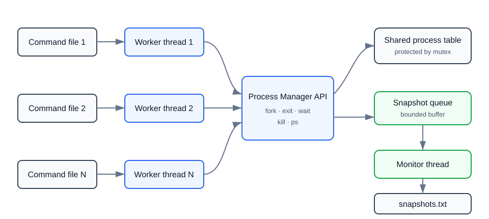
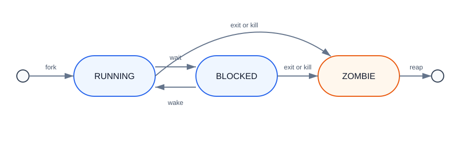
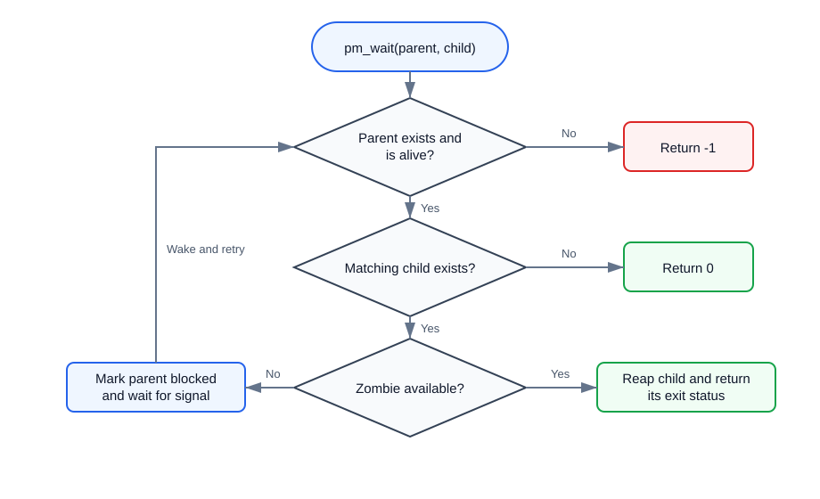

# Multithreaded Process Manager

A thread-safe process manager simulator written in C with POSIX Threads. Multiple workers execute command files concurrently against a shared process table, while a dedicated monitor records a consistent snapshot after every state change.

## Features

- Concurrent command processing with one worker thread per input file
- Thread-safe process creation, termination, waiting, and inspection
- `RUNNING`, `BLOCKED`, and `ZOMBIE` process states
- Parent-child relationships and zombie reaping
- Condition-variable-based waits without busy polling
- Bounded producer-consumer queue for snapshot events
- Ordered event logging to `snapshots.txt`

## Architecture



Worker threads parse commands and call the process manager API. A mutex protects the shared process table, making each operation atomic. State-changing operations copy a snapshot into a bounded event queue, allowing the monitor to perform file I/O without holding the process-table lock.

## Process Lifecycle



- **RUNNING** — the process is active.
- **BLOCKED** — one or more workers are waiting for one of the process's children.
- **ZOMBIE** — the process has terminated but has not yet been reaped by its parent.

## Wait Behavior



Passing `-1` as the child PID waits for any child. If multiple children are zombies, the child that exited first is reaped first.

## Requirements

- GCC or Clang with POSIX Threads support
- Linux, macOS, WSL, MSYS2, or another POSIX-compatible environment

Native Microsoft Visual C does not provide the POSIX `pthread` API used by this program. Windows users can build it with WSL or MSYS2.

## Build

```bash
gcc -std=c11 -Wall -Wextra -Wpedantic -pthread process_manager.c -o process_manager
```

## Command Files

Each input file contains one command per line. Blank lines and lines beginning with `#` are ignored.

| Command | Description |
|---|---|
| `fork <parent_pid>` | Create a running child of the specified process. |
| `exit <pid> <status>` | Terminate a process with an exit status. |
| `kill <pid>` | Terminate a process with status `-9`. |
| `wait <parent_pid> <child_pid>` | Wait for a child; use `-1` for any child. |
| `sleep <milliseconds>` | Pause the current worker. |
| `ps` | Print the current process table. |

The process table starts with PID 1 in the `RUNNING` state. New PIDs begin at 2.

Example `thread0.txt`:

```text
# Create PID 2, then wait for it
fork 1
sleep 100
wait 1 2
ps
```

Example `thread1.txt`:

```text
sleep 50
exit 2 0
```

When multiple files issue `fork` concurrently, PID assignment follows lock-acquisition order and may vary between runs. Use `sleep` when a scenario depends on a specific ordering.

## Run

Pass one or more command files. The program creates one worker thread for each file:

```bash
./process_manager thread0.txt thread1.txt
```

## Output

The `ps` command prints the current process table:

```text
PID    PPID   STATE      EXIT_STATUS
---------------------------------------------
1      0      BLOCKED    -
2      1      ZOMBIE     0
```

Every state change is also written to `snapshots.txt` with the triggering action and a full process-table snapshot. The file is recreated on each run.

## Limits and Semantics

| Item | Limit or behavior |
|---|---|
| Process table | 64 entries |
| Children per process | 64 |
| Snapshot event queue | 512 entries |
| Input line | 255 characters |
| Initial process | PID 1, parent PID 0 |
| Orphan handling | Children are not recursively terminated or reparented |

Invalid or impossible commands are reported to standard error.

## Repository Layout

```text
.
├── docs/
│   ├── architecture.svg
│   ├── process-lifecycle.svg
│   └── wait-flow.svg
├── process_manager.c
├── README.md
└── .gitignore
```

## Technical Concepts

The implementation demonstrates mutex-based mutual exclusion, condition-variable synchronization, thread-local storage, producer-consumer queues, process states, zombie processes, and safe concurrent access to shared state.
